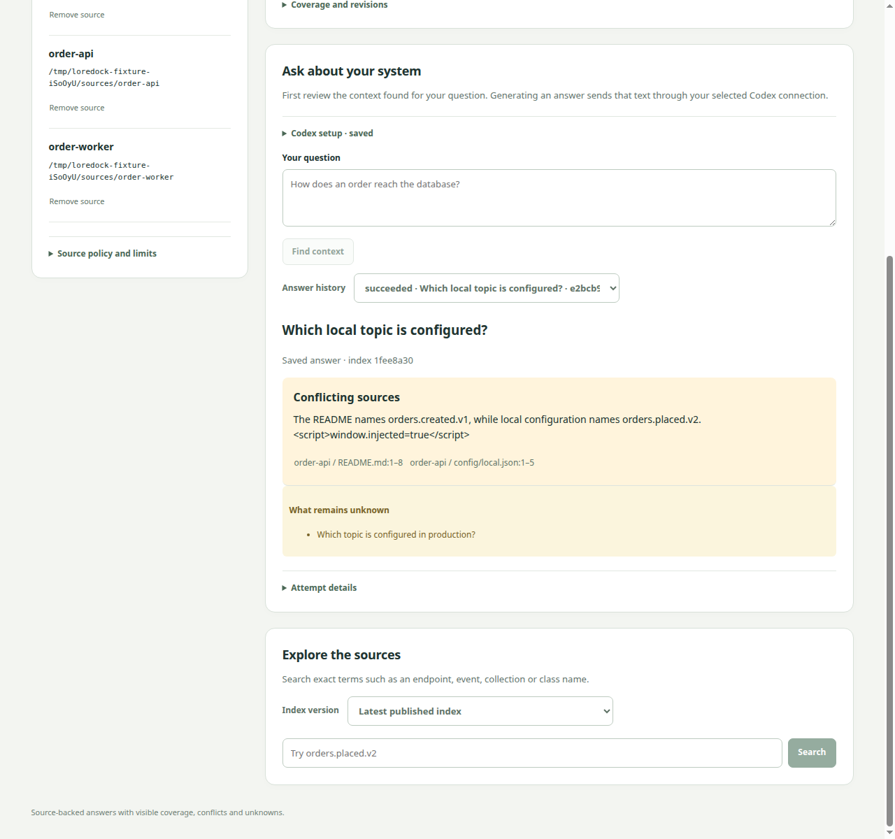
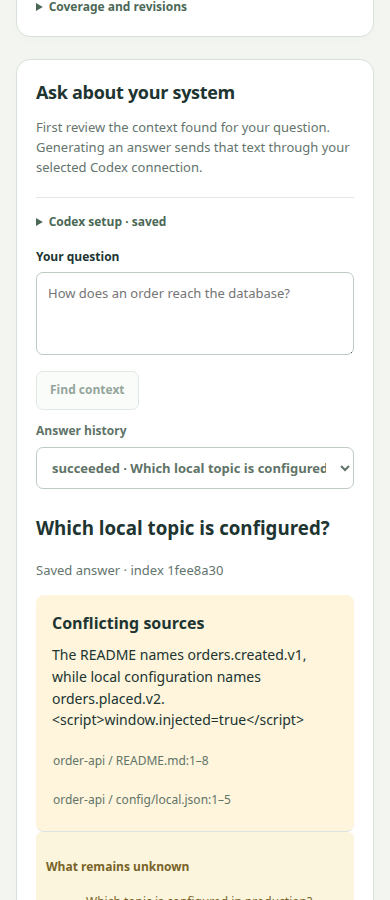

# LoreDock answer-quality and CLI refresh evidence

Historical review checkpoint. The [subsequent owner acceptance](../../loredock/L2_ACCEPTANCE.md)
records the completion acknowledgement after merged PR #20. Original agent scores, raw
results and per-question review boxes below are preserved without inventing a human score.

Date: 2026-10-30. Linux / Node 22.23.2 / Codex 0.166.0 /
gpt-5.6-terra / medium. Task 016 is **ready for human semantic review**, not accepted.
Ordinary startup remains model-free; the pilot requires `LOREDOCK_ANSWERS=1`.

The final complete run receives a provisional **20/20 useful/correct agent assessment**,
with **162/162 mechanically resolving citation references across 98 claims**. All 289
input-span occurrences were checked against the frozen fixture bytes, line ranges and
SHA-256 hashes. These are occurrence/reference counts, not distinct evidence counts.
An independent human must review the semantic judgments before default activation.

Start with the [readable review sheet](HUMAN_REVIEW.md), which contains every final
claim, unanswered question and source link, plus unchecked human-review boxes.
[Agent assessment](semantic-review-v6.json) records per-question notes. Pay particular
attention to the conditional projection/receive wording in q10 and q18: static intended
flow does not establish observed runtime delivery or database safety.

## Complete evaluation history

The corpus, oracle, threshold and future routing cases are unchanged. Only question
strings enter the production retriever/runtime. These are complete runs, not a set
assembled from the best answer to each question.

| Run | Application attempts | Assessment and reason for the next change |
| --- | --- | --- |
| [v3 raw result](answer-result-v3.json), [review](semantic-review-v3.json) | 18/20; stopped on operational failure | 15/20 useful/correct under agent review. q04 hides a known conflict in a question; q05 omits the README conflict; q18 uses a content hash as a locator and is rejected. q19/q20 are not run. |
| [v4 raw result](answer-result-v4.json), [review](semantic-review-v4.json) | 20/20 | 19/20; q04 omits the required identity authentication/authorization caveat. Numeric threshold alone does not pass the safety gate. |
| [v5 raw result](answer-result-v5.json), [review](semantic-review-v5.json) | 20/20 | 19/20; q11 manufactures a conflict between an agreed local value and an unknown production value. Reject that unsupported conflict. |
| [v6 raw result](answer-result-v6.json), [review](semantic-review-v6.json) | 20/20 | Provisional 20/20 agent assessment; required conflict/unknown cases pass agent review. Independent human approval remains pending. |

The [September pilot](../loredock-answers/README.md) retains v1/v2 and its 17/20 result.
The original [10/20 retrieval baseline](../loredock-answer-foundation/README.md) is also
preserved. None of these historical measurements is relabeled as accepted.

New decoder schema `cited-answer-v3` restricts citation choices to the issued IDs;
empty contexts permit no claims. Unknowns are questions, while source-backed explanations
and documented absences belong in cited claims. Prompt v6 preserves scoped conflicts,
distinguishes environment gaps from contradictions and separates identity propagation
from authentication/authorization. These constraints reduce specific failure modes;
they are not semantic proof or a guarantee for other corpora/paraphrases.

## Other records

| Artifact | Evidence and scope |
| --- | --- |
| [Retrieval](retrieval-result.json) | 20/20 complete expected-evidence sets; q14 uses a clearly labeled bounded orientation sample, not a lexical match. Zero model calls. |
| [Runtime](runtime-result.json) | Eight helper checks, 14 synthetic protocol requests, actual Code Mode inventory, blocked patch/shell calls, empty MCP resource/template lists and rejected unconfigured-server read. Zero real models. |
| [Selected preflight](selected-preflight.json) | The previously selected personal configuration passes no-model preflight with the canonical 0.166.0 launcher and text-only-v2 policy. No authentication/session stores were parsed or copied. |
| [Browser](browser-result.json) | Four fake runtime calls; model-free orientation preview, conflict/citation, escaped prose, abstention, failure/cancel retention, restart/history and 390px layout. Zero real models. |

CLI 0.166.0 advertises three MCP resource primitives in Code Mode. They have no resource
access when every MCP server is disabled, as required by production preflight. This
qualification does not turn production's read-only/capability restrictions into the
strict filesystem namespace tested separately by the helper. Global home instructions
still appear in the synthetic request; the production global-AGENTS rejection remains
necessary. The probe's standalone `not-qualified` field deliberately does not establish
selected-account or answer-quality acceptance. Read the full evidence alongside
[ADR 0021](../../decisions/0021-loredock-answer-quality-and-cli-refresh.md).

Desktop and mobile captures use fake test prose, not real model answers:

## Budgets and verification

Every model evaluation permits at most 20 application attempts, one active invocation,
120 seconds per attempt and no automatic application retries. Four new runs consumed
78 application attempts; the first stopped after its failed answer. CLI-reported usage:

| Run | Input tokens | Output tokens | Cached input tokens (included in input) |
| --- | ---: | ---: | ---: |
| v3 | 200,741 | 6,858 | 24,320 |
| v4 | 230,137 | 9,150 | 0 |
| v5 | 232,077 | 10,659 | 0 |
| v6 | 232,534 | 8,967 | 0 |
| Total this iteration | 895,489 | 35,634 | 24,320 |

These counts are neither monetary estimates nor predictions for 20 real repositories.
CLI/provider transport can make internal requests within the wall limit; interruption
does not guarantee zero provider usage. No hidden application retries, oracle-fed prompts,
routing evaluation, corporate source ingestion or source-checkout mutation occurred.

`pnpm check` passes 186 tests, strict typechecks and production builds. The final prompt
and historical-context compatibility changes also pass all 35 LoreDock tests. Frozen
offline installation succeeds with the added workspace-only type dependency. Existing
Workbench runtime versions and behavior are unchanged. Use the reproduction commands
in the [earlier pilot record](../loredock-answers/README.md#reproduce); the real evaluator
uses the explicit selected executable/configuration and a new result directory each run.

Repository artifacts contain JSON, Markdown and screenshots only. SQLite ledgers remain
in local evaluation directories; no credentials, authentication stores or normal user
data are committed. All temporary source checkouts were verified unchanged and removed.
