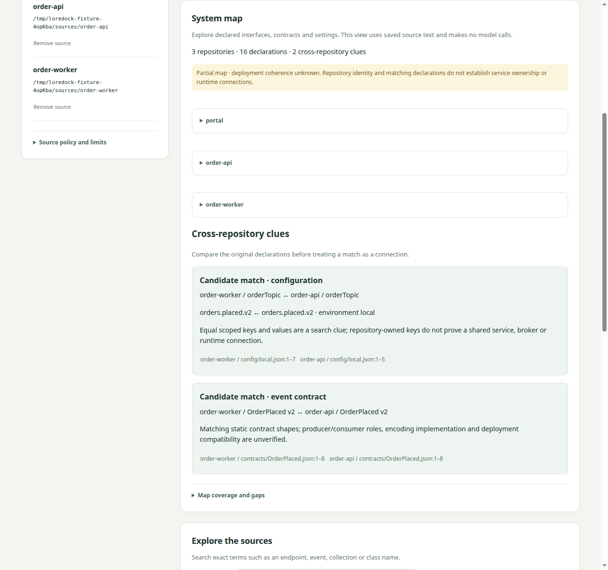
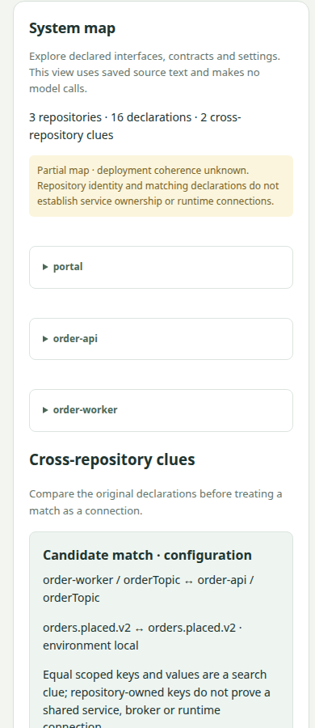

# LoreDock declaration-map evidence

Date: 2026-10-30. Linux / Node 22.23.2. Task 017 is the first bounded L3 delivery;
full code-flow reconstruction and semantic graph editing are not accepted here.
All checks below made **zero real model calls**.

## Results

The [model-free evaluation](map-result.json) indexes the unchanged frozen corpus
through the production catalog and declaration mapper. It returns:

- Three repository identities and 16 separate declarations: three package identities,
  two HTTP routes, one unresolved handler reference, two event contracts and eight
  scalar configuration values.
- 16 repository/declaration membership links and two route/handler references.
- Two cross-repository candidate clues: matching event-contract shapes and the matching
  explicitly local topic setting. Neither establishes producer/consumer or deployment roles.
- Nine original evidence records, reopened with source revision, file/span hashes and
  line ranges verified by the existing evidence service.

Entities are namespaced by build/source/file/declaration. Equal `OrderPlaced` names and
identical source text remain separate nodes. A repeat read of the same authorized build
and registry reproduces the projection hash; fresh imports deliberately receive new
build/source identities. The map is partial and deployment coherence remains unknown.
The evaluator never supplies the oracle to product code or runs source commands.

The [browser result](browser-result.json) verifies route and contract citations,
candidate labels, old/current index selection, source removal, policy fencing, reindex,
restart and 390px layout. It also verifies that a malicious package name is escaped
text, creates no image element and executes no handler. That browser test commits an
adversarial package-name variant only inside its owned temporary fixture; the frozen
corpus files are unchanged. `sourceCheckoutsUnchanged` measures preservation during
application actions relative to that controlled starting revision.

The [answer browser regression](answer-browser-result.json) still passes orientation
preview, conflict/citation, escaped answer prose, abstention, failure/cancel retention,
restart/history and mobile layout. Its four invocations use an injected fake runtime.
The old generic citation selector was scoped to the answer result after map citations
were added; the production citation-opening behavior is unchanged.

`pnpm check` passes **197 tests**, strict typechecks and production builds. Eleven new
map tests cover source-scoped identities, exact evidence, changed contracts/historical
pins, environment separation, unsupported shapes, hostile labels, all admission/graph
budgets, metadata tampering, missing/damaged spans, policy/revocation, empty maps,
deterministic restart and protected HTTP reads. No database migration, external package,
account configuration change or model evaluation was needed.

## Browser captures





## Reproduce

Build with the pinned toolchain; keep port 4244 free for Chrome:

```sh
pnpm check
node scripts/loredock-map-evaluation.mjs
node scripts/loredock-smoke.mjs
node scripts/loredock-answer-smoke.mjs
```

The map evaluator uses disposable local source/catalog directories and no browser.
Browser scripts own their daemon, Chrome profile and source fixtures; they stop owned
processes and remove temporary inputs afterward. No normal user checkout or database
is changed. Screenshots and JSON contain synthetic data only.

## Boundaries and continuation

Only direct package/Maven identity and the documented JSON declaration shapes are
mapped. Unsupported/large declarations are counted, not guessed. Scope comes from
explicit environment data, not a `local.json` filename. Configuration differences are
not automatically promoted to production conflicts. Read-time authorization, full
document-span coverage and source-byte checks precede every parsed declaration.

The next L3 slice must resolve code-to-declaration ownership, actual callers/producers/
consumers, two static flows and engineer-supplied corrections. No automatic repository
routing or Workbench bridge is delivered by this map. See
[ADR 0022](../../decisions/0022-loredock-declaration-map.md),
[Task 017](../../../tasks/017-loredock-declaration-map.md) and the
[user guide](../../loredock/USER_GUIDE.md#explore-the-declaration-map).
