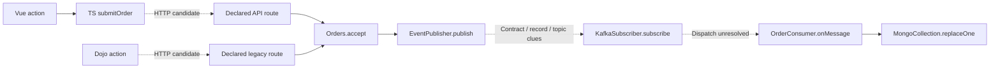

# LoreDock static-flow acceptance evidence

Date: 2026-10-30. Scope: [Task 018](../../../tasks/018-loredock-static-flows.md),
the second bounded L3 slice. Implementation-agent verification is recorded here;
full L3 and production framework acceptance are not claimed.

## Results

The production projection reads the original frozen three-repository corpus, without
an oracle/model input. [flow-result.json](flow-result.json) records the unchanged
original revision vector, deterministic projection hash, coverage, nodes/links/outlines
and all ten resolving original evidence locators/hashes. All five candidate code files
were examined (2,685 UTF-8 bytes); no adapter work was omitted for the original corpus.

- Six code symbols, two HTTP calls, one publish, one subscription and one document
  write; two declared routes and one handler reference retain their separate identities.
- Two outlines: Vue/TypeScript (10 steps) and Dojo (nine steps), sharing the Java
  handler/publisher and candidate consumer/document-write tail.
- Thirteen links, including four candidates: two HTTP targets, one event-delivery
  comparison and one unresolved subscriber dispatch. Each outline has three candidate
  hops. Active environment and deployment coherence remain unknown.
- Matching record/contract shapes and one local topic comparison support navigation,
  not runtime config binding, a shared broker, serialization, callback dispatch or a
  concrete MongoDB database/collection. All six wiring/deployment gaps are retained
  per outline. Syntax links do not establish execution order.



Solid arrows summarize supported source syntax/declarations. Dotted arrows are
candidate hops. Neither arrow style certifies observed runtime behavior.

## Verification

Full `pnpm check`: strict typechecks, production builds and **216 tests** (17 Git,
18 AI, 43 storage, 65 LoreDock, 57 daemon and 16 script tests). New coverage includes
parser/shadowing/dynamic syntax boundaries, ambiguous names/imports, record/contract/
environment mismatch, literal-topic contradiction, full multi-span proof, budgets,
policy/revocation, pinned history, restart and protected HTTP access.

[browser-result.json](browser-result.json) records both outlines, original write
evidence, candidate/gap labels, deliberately reordered citation responses with the
last selection retained, historical/current indexes, source removal, policy/reindex,
restart and the 390px layout. The browser owns temporary sources and changes only its
temporary package label to adversarial HTML; it checks escaped rendering and no script
execution. Frozen corpus files are unchanged. See [desktop](desktop.png) and
[mobile](mobile.png) screenshots.

The first browser attempt exposed citation clicks dropped while the old global busy
handler refreshed project state. Evidence reads now run independently with sequence
and scope guards. The final browser test holds the older response until the later
selection is visible, then releases it and verifies the selection is retained.

[answer-browser-result.json](answer-browser-result.json) records the existing answer
regression: four fake invocations, preserved failure/cancellation history, citations,
escaped output, restart and mobile behavior. **Zero real model calls** were made by
this iteration. Source checkout status is unchanged after all evaluations.

## Reproduction

Use the pinned Node/pnpm versions and a frozen-lockfile installation:

```sh
pnpm check
node scripts/loredock-flow-evaluation.mjs > /tmp/loredock-flow-evaluation.json
node scripts/loredock-smoke.mjs
node scripts/loredock-answer-smoke.mjs
```

The Chrome scripts require Linux, `google-chrome` and free port 4244; run them
sequentially. They create/clean their own data directories and never read normal
application data or invoke a real model. The mapper accepts only stored indexed input,
not the fixture oracle. The declaration map stays on its existing versioned contract;
the new code projection is `loredock-code-flows-v1` / `pilot-code-v1`.

Real Java frameworks, custom Vue/Dojo wrappers, broader language syntax, durable
engineer corrections, 20-repository scale and the Workbench bridge need separate
iterations and evidence. See [ADR 0023](../../decisions/0023-loredock-static-code-flows.md).
