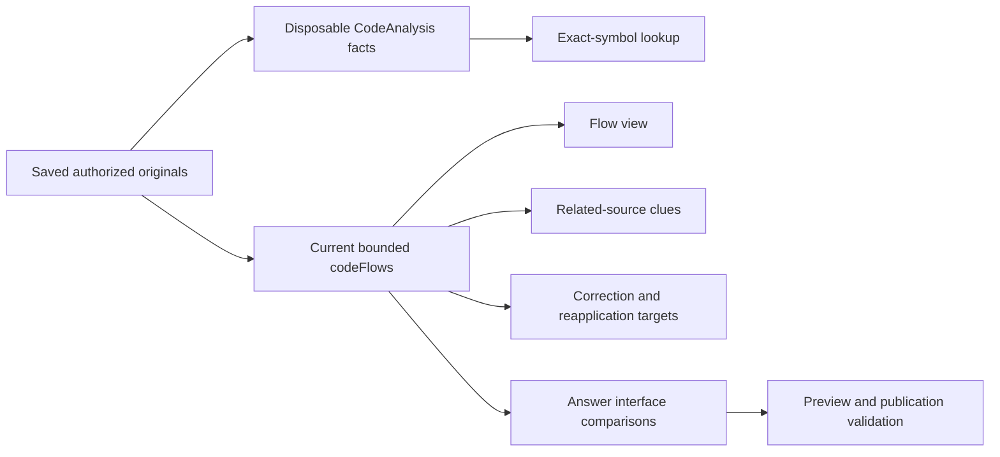

# Durable facts and wider flow context

Status: design reviewed against `ef720f0`, 2026-11-01. Task 061 is analysis only.
The original prospective contract below was executed offline by Task 062; see the
[retained results](../fixtures/loredock-durable-flows/README.md). Production selection is unchanged.

## Recommendation

Do not replace the current flow file loop with the complete inventory. First compare
validated saved facts with the exact existing sample, then measure wider fact coverage
separately from graph admission. Preserving facts does not preserve selected relationships:
node admission, ambiguity, declaration coverage and comparison budgets can change the graph.
Keep production flow/candidate/answer/correction behavior unchanged during that experiment.

Task 062 implements the prospective offline comparison below. A parity
pass permits considering a shared fact-to-graph assembler; it does not authorize wider
selection or a production switch. A wider candidate that loses required support or weakens
ambiguity must be rejected, with its negative results retained.

## Existing contracts

| Area | Current implementation | Implication |
| --- | --- | --- |
| Flow inputs | [`codeFlows`](../../apps/loredock/src/code-flows.ts) reparses up to 100 indexed TS/JS/Vue/Java files. Within each source: shortest path, then path; across sources: position, source ID, path. Text is capped at 256 KiB, 32 KiB/file and eight spans/file. | Inventory ordinal order is not equivalent. Even an identical source set can admit different nodes if read order changes. Source IDs are opaque IDs, not registration order. |
| Graph admission | The same module caps 160 nodes, 240 edges, 2,000 counted HTTP/event comparisons, two outlines, twenty steps, 1,000 traversals and 512 KiB output. | More parsed files cannot make this a full graph. `comparisons` is a counter for two matching loops, not a bound on every operation or a hard time limit. |
| Declaration input | [`declarationMap`](../../apps/loredock/src/system-map.ts) independently caps 100 documents / 256 KiB, 150 nodes, 250 edges, 2,000 comparisons and 512 KiB. | Code facts cannot fill omitted JSON routes, contracts, environment settings or handler references. Both coverage layers must remain visible. |
| Durable inventory | [`CodeAnalysis`](../../apps/loredock/src/code-analysis.ts) captures indexed code candidates in saved source-row/path order. Limits in [`code-analysis-types`](../../apps/loredock/src/code-analysis-types.ts) are 10,000 units, 50 MiB original input, 16 MiB serialized payload, 128 KiB/file payload and five minutes active time; original per-file/span bounds match the graph. | The inventory can be published as partial, including syntax gaps, omitted payloads and unattempted files. A graph-selected file need not have retained facts. |
| Compatible read | `snapshot()` requires publication, matching parser/limits, current policy/registry and a valid complete manifest/checkpoint/counter set. `file()` validates payload identity/hash, full original text/blob/spans and fact ranges. | Use the service, not direct JSON table reads. Each fact read still validates original text; this saves parsing, not all source I/O. |
| Identity | [`codeAnalysisFingerprint`](../../apps/loredock/src/code-analysis-facts.ts) hashes installed parser, validation/service/extraction modules, TypeScript and Node. Source and compiled identities differ. | Refactoring the service itself can require reanalysis even if parser semantics did not change. No automatic relabeling of old inventories. |
| Lifecycle | Starting a new inventory retains the newest published run and replaces other retained runs. Policy or registry changes fence derivatives; source registration counts too. [`CodeAnalysisFollow`](../../apps/loredock/src/code-analysis-follow.ts) observes new publications without resuming old attempts. | An old index may retain original source evidence while its matching facts are absent. A published result can be unavailable during a later yielded read. |
| Async precedent | [`lookupCodeSymbols`](../../apps/loredock/src/code-symbols.ts) validates a snapshot, yields per file, checks a five-second cooperative budget and rechecks manifest/scope before returning. | Reuse this lifecycle pattern for a wider reader. Existing synchronous graph consumers cannot be converted by changing a single loop. |

The archived [Task 044 measurement](../fixtures/loredock-code-inventory/README.md) already
illustrates the distinction: the inventory examines 3,621 files, while the graph samples
100; an additional `Orders.accept` method is visible in the larger inventory. That result
establishes source syntax, not a complete route/flow. It is not rerun by this design.

## What can be reused

[`AnalysisPayload`](../../apps/loredock/src/code-analysis-types.ts) retains `CodeFacts`,
original identity/evidence and UTF-16-derived line/hash ranges. These are the same parser
fact types that the graph consumes:

- Symbols carry keys, qualified names, export flags, roles and parameter/class information.
- Operations carry owners, kinds, offsets and properties. `recordSignature` must remain
  available for candidate matching even though the current node presentation omits it.
- Calls retain owner/import/module names. They have no separate stored call range; the
  graph currently cites complete supporting files. Do not manufacture a call-site locator.
- Java record signatures and explicit parser gaps remain necessary for delivery matching
  and coverage; a list of symbol names alone is insufficient.

After `file()` has validated a payload, its symbol/operation range records can supply the
same line numbers as the current source-offset calculations. The graph's later logic uses
facts/identity/references rather than arbitrary source text. Full originals still have to be
validated by the service and reopened through ordinary evidence. Do not trim references
to an operation line: imports, receiver declarations, record shapes or types can occur
elsewhere in the supporting file. Preserve the complete support used by current nodes.

Fact hashes/ranges provide integrity within the trusted local installation. They do not
independently prove parser semantics or observed runtime behavior. Parity against current
parsing is a separate check; semantic/private-pilot acceptance remains separate again.

## Why selection and compatibility need separate work

The current graph admits symbols before operations within each file, and code nodes before
adding declaration nodes. A dense file can consume the node budget before a route or useful
operation is represented. Relative-import and handler resolution search admitted symbols;
adding another matching symbol can turn a previously unique match into ambiguity. HTTP
method/path matches remain candidates, and event delivery also needs compatible JSON
contract/topic scope and a unique supported consumer/write. Full fact coverage cannot
prove runtime dispatch, broker wiring, collection ownership or deployment coherence.

The dependency chain is broader than the graph UI:

[`candidateLinkContext`](../../apps/loredock/src/candidate-links.ts) derives cross-source
clues and pagination from graph edges. [`Corrections.write`](../../apps/loredock/src/corrections.ts)
recomputes the graph/input hash before saving an immutable target snapshot and affected
flow IDs. [`Reconciliation`](../../apps/loredock/src/reconciliation.ts) explicitly recognizes
`loredock-code-flows-v1` / `pilot-code-v3` and compares unique semantic support before
reapplication. Code-generated node/edge/flow IDs incorporate build identity and the adapter's
ID namespace; copied declaration nodes retain their declaration-map IDs.

[`answerInterfaces`](../../apps/loredock/src/answer-interfaces.ts) admits at most six
comparisons / 8 KiB only when every supporting span is already in the question context.
[`validateCitedAnswer`](../../apps/loredock/src/answer-context.ts) recomputes those derived
comparisons before publication. Switching to whichever inventory finishes most recently
could change an in-flight answer's expected derivation even when its original passages
are unchanged. Wider graphs must not enter this path implicitly.

A future production proposal therefore needs a separate adapter/projection identity and
explicit provenance (selected index, inventory ID/fingerprint/manifest and selection version).
It must preserve saved answer/review bytes and keep the old derivation available where
historical validation/reapplication requires it, or explicitly report that the old adapter
is unsupported. Never reassign old corrections to new edges just because labels match.
No persistent history may depend solely on an evictable fact run.

## Reader and fallback contract for the experiment

Select a compatible published inventory for the requested authorized index. Validate its
snapshot, read only through `file()`, yield between files and revalidate the same snapshot
identity/scope before issuing results. Use the existing per-file/inventory bounds and a
five-second cooperative read budget; this is not a hard OS deadline. Report scan/validation
and graph-assembly time separately. No new analysis starts as a side effect of a read.

| Condition | Required experimental outcome |
| --- | --- |
| No compatible published inventory, or an evicted historical run | Explicit unavailable; no empty graph presented as complete and no hidden analysis/retry. The independent legacy graph can still be shown as a separately labeled control. |
| Published partial inventory | Preserve parsed, excluded, failed, omitted, unattempted and syntax-gap counts; distinguish complete retained-file scan from complete original-source coverage. |
| Selected parity file has no retained payload | Parity unavailable with the missing file/reason recorded. Do not silently substitute freshly parsed facts and call it a cache-only parity pass. |
| Old parser or changed limits | Refuse compatibility; record the mismatch. |
| Corrupt manifest/checkpoint/payload/original | Fail visibly. Do not repair, bypass validation or fall back to another run. |
| Registry/policy change or run eviction during a yielded scan | Discard the pending result. Adding a source is also a registry change; do not weaken the service's fence to match legacy filtering. |
| Read budget reached | Explicit partial diagnostic with scanned/unscanned counts. Never silently claim all files were examined. No default production promotion from a timed-out comparison. |

Any future UI needs its own request/scope fences for asynchronous projection responses.
Fact availability and graph completeness must remain distinct. A separate user setup form,
global platform rewrite, automatic provider selection or Workbench migration is unnecessary.

## Prospective offline comparison

In a new task, commit scope first, then freeze generated input/oracle and prototype identity
before collecting observations. Use fresh owned copies of synthetic sources and
independently authored expected relationships.
Existing examples are known to the author; this is not a blinded semantic benchmark.
Do not rerun Tasks 034/044/048 or other consumed receipts, overwrite frozen outputs, contact
models or read corporate sources.

Keep production unchanged. Use an explicitly identified experimental assembler based on
the pinned graph algorithm and compare it with the unmodified production result. If that
requires a production refactor, scope and verify parity for the refactor separately before
using it to measure wider selection. Never label prototype output as the current adapter.

Three fixed modes, without adaptive tuning during the run:

1. **Production control:** current file selection, parsing, declaration input and graph caps.
2. **Saved-fact parity:** the exact same admitted files in the exact same order, with saved
   validated facts/ranges. Preserve current limits, original support and assembly semantics.
3. **Wider diagnostic:** visit all admitted retained facts in explicit inventory order,
   preserving current graph/declaration/output caps. Record which additional facts become
   available and which required nodes/links still fail graph admission. This naive mode is
   diagnostic, not a recommended selection policy or an automatic promotion candidate.

The parity mode preserves the 100-file / 256 KiB selection. The wider mode deliberately
replaces only that experimental input selection with the retained inventory (at most the
600-file corpus below, within its existing 50 MiB input / 16 MiB payload bounds and the
five-second reader budget). Report the extra validated bytes and files explicitly. No
production budget changes, graph-cap increases or declaration-cap increases are authorized.

Use at most 600 code files per fresh variant for this first comparison. This exceeds the
old sample while keeping the experiment small; it is not a new full-volume benchmark.
Freeze concrete source bytes, expected locators/relationships and scenario counts before
running the prototype. The scenarios below are mandatory, not a menu to prune after results.

| Case | Prospective input | Required oracle/observation |
| --- | --- | --- |
| F01 Small parity | Fresh three-source Vue/TS, Java API/worker and Dojo baseline, unchanged syntax. | Exact selected files, facts, ordered graph/outline semantics, support, omissions and limits must match the production control. Compare provenance separately; no new semantic claims. |
| F02 Long-path support | Add 120 small, short-path no-operation TS files to each of the three baseline sources so original handler/caller paths fall outside the first 100 files. | Full facts must retain the original required handlers/operations. Report their graph presence separately. Filler symbols cannot count as recovered end-to-end support. |
| F03 Dense first file | Add a short-path file containing 200 supported exported functions, within original/payload bounds. | Preserve the distinction between examined facts and graph slots; record displaced original nodes/routes/operations. A wider result that loses required support cannot be promoted. |
| F04 Ambiguous matches | Add same-source alternatives for an otherwise unique named-import/handler target using supported syntax. | Do not select an arbitrary match or retain a unique implementation assertion after ambiguity. Record source/path-qualified alternatives. |
| F05 Unresolved wiring | Add unsupported/non-relative imports, an unbound HTTP authority, and contradictory literal topic/environment declarations. | Retain unresolved/candidate status and relevant gaps. No new static runtime connection, dispatch or concrete database ownership claim. |
| F06 Availability and partial coverage | Read with no inventory, an unpublished run, and published reduced-budget/unsupported-syntax runs. | Explicit availability and per-unit omissions. Missing parity files invalidate parity; remaining retained facts do not imply complete source coverage. |
| F07 Integrity and parser identity | Independently damage a checkpoint, payload, original or parser marker in owned data. | Visible failed/unavailable result, with no silent fallback or partial corrupt publication. Preserve the first failure observations. |
| F08 Yielded scope changes | Add/revoke a source, change policy and evict the selected run between scan yields in separate cases. | No stale result is published. No consumed original/source data may reappear after the corresponding fence. |
| F09 History and restart | Build two revisions, read both, restart, then create enough inventories to evict the oldest. | Surviving compatible runs preserve exact identities. Evicted facts become unavailable while retained original citations/legacy controls remain independently governed. |

Record full machine-readable file vectors, graph/outline/support vectors, unavailable/error
states and per-case expected-versus-observed results. Include source/implementation hashes,
Node/parser fingerprint, sampled process RSS (with its sampling limits), validation/assembly/
wall time, input/payload/output bytes, source and scope identities, scanned units, all omission
counters, original evidence reopen results, Git calls and SQLite writes during projection.
Preparation/indexing may write; measured projection must make zero Git calls and DB writes.
Use first and one same-snapshot repeat measurements; retain both rather than selecting the
faster observation. Reset mutated lifecycle/integrity cases on fresh owned data.

Reject production integration if parity differs without an explained prior contract change,
any support fails to reopen, ambiguity is weakened, fences fail, scan/output caps are hidden,
or required source support is lost. A naive wider diagnostic is allowed to fail these
promotion gates; recording that failure completes the experiment, not the wider feature.
If selection needs revision, author a new prospective contract and counterexamples before
tuning. Passing this experiment would still not establish semantic L5 readiness, a private
pilot, independent human review or Workbench routing acceptance.

## Task 062 result and next boundary

The [retained comparison](../fixtures/loredock-durable-flows/README.md) confirms bounded
saved-fact parity but rejects the naive wider graph: 365 retained files recover all seven
critical facts, while the 160-node graph admits only three required nodes. The dense-file
assumption also missed the existing 100-symbol per-file parser caps (TypeScript and Java);
its 200-function input retains 100 and does not saturate the graph. This failure remains
recorded; no retrospective fixture/oracle change is made.

The next prospective contract should resolve supported ambiguity against all retained
facts before choosing displayed nodes, then admit bounded complete supporting relationships
with explicit omitted branches. Evaluate fresh multiple-dense-file and competing-root
cases, preservation of supporting imports/types/records, and alternatives outside displayed
slots. No new ranking policy is implemented or accepted by this recommendation. Keep
current answer/correction provenance separate and preserve all failed semantic gates.
