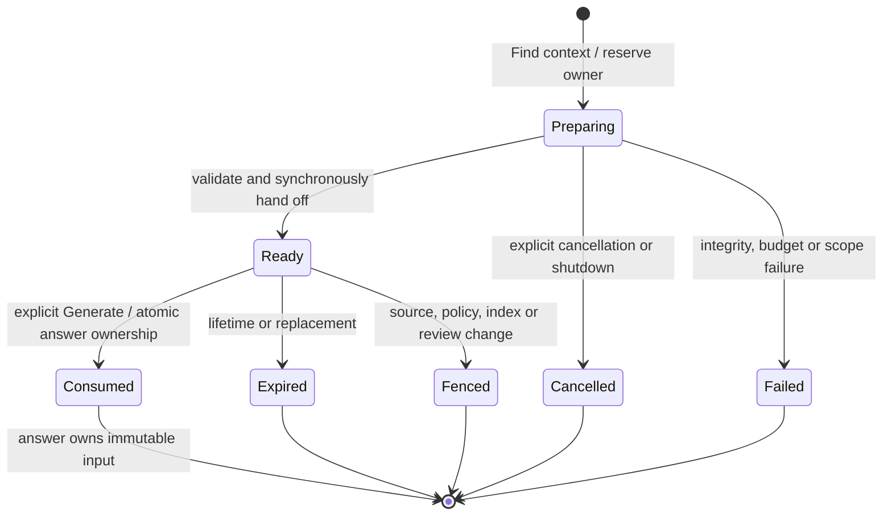

# Immutable question preparation and answer-owned witnesses

Status: Task 121 prospective production design, 2026-11-04. No implementation, migration,
model request or default UI change. [ADR 0059](../decisions/0059-loredock-prepared-question-lifecycle.md)
records the decision. Task 120 / PR #124 passed push 41926249765 and pull-request 41926293151
at `647efad`, then merged with an identical tree at `4bbc0c1`.

## Product flow and current boundaries

Keep the existing flow: **Your question → Find context → review → Generate answer**.
Find context uses the current published source index and compatible native inventory;
the user supplies no repository, root, generation, parser or budget selector. Show the
selected static path as an optional reading aid, alongside the existing originals,
engineer notes and legacy HTTP clues. Missing, ambiguous or oversized native context
keeps the useful source context and a clear omission reason. Integrity, cancellation,
concurrent work or source-fence errors fail the preparation instead of pretending that
no connection exists. Finding context needs no model connection; generation retains the
existing opt-in answer mode and explicitly selected connection.

The [44-case offline pass](NATIVE_QUESTION_CONTEXT_RESULT.md) justifies production seams
and lifecycle work. It does not qualify a new prompt, semantic answer quality, broad
natural-language relevance, large-graph behavior or automatic repository routing.

| Audited implementation | Current behavior | Required integration boundary |
| --- | --- | --- |
| [Answers.preview/start](../../apps/loredock/src/answers.ts) | Synchronous retrieval is recomputed and its hash compared at start, before reserving a worker. | Keep the legacy path intact. Native preparation gets its own owned asynchronous phase; prepared start consumes a server-held snapshot. |
| [Runtime and publication](../../apps/loredock/src/answers.ts) | One worker; runtime preparation precedes dispatch; late cancellation wins; usage survives failed validation. | Reauthorize the exact stored native witness before dispatch and publication, preserving usage and cancellation semantics. |
| [Answer validation](../../apps/loredock/src/answer-context.ts) | Checks every original, source/review scope and legacy comparisons. | Native validation additionally checks the issued witness, never the latest inventory; original-only citations remain unchanged. |
| [Store and recovery](../../apps/loredock/src/store.ts) | Attempt/context/dependencies are inserted transactionally; preparing/running attempts become interrupted on restart. | Preview is transient. A new answer-owned witness row is inserted atomically with a new-mode attempt; restart never dispatches it automatically. |
| [Revocation](../../apps/loredock/src/catalog.ts) and [purge](../../apps/loredock/src/store.ts) | Source inactivity precedes boundary callbacks and purge; answer text is purged through answer_sources. | Clear transient snapshots on the callback and purge answer-owned witness text in the same dependent-answer transaction. |
| [AnswerPanel](../../apps/loredock-web/src/AnswerPanel.tsx) | Question/authority/review changes hide previews, but the request is a synchronous preview response. | Track a preparation ID/sequence; hide old content before cancel/replacement and ignore late responses. |
| [Native producer](../../apps/loredock/src/code-paths-v2.ts) | Complete resolution precedes display admission, under one path owner. | A trusted typed selection seam runs before admission; public paths/root pages remain unchanged. |
| [Offline preparation](../../scripts/loredock-native-question-context/prepare.mjs) | Trusted fixture adapters temporarily count actual SQL rows/original bytes by wrapping methods. | Production requires scoped read accounting, not application method replacement or client-provided budgets. |
| [Shutdown](../../apps/loredock/src/index.ts) | Captures/paths/analysis stop before legacy Answers. | Stop preparation and native-answer consumers before their path/analysis dependencies and storage. |

## Selected ownership model

Use one catalog-owned preparation service and one transient snapshot slot, separate from
the 64 user-saved native receipts. The slot holds the exact context, compact item/omission,
receipt when available, rendered prompt, full scope and version/hash metadata. It is never
rebuilt from browser JSON. An opaque random preparation ID locates this trusted server
state; a content hash detects changes but grants no authority by itself.

| Alternative | Decision |
| --- | --- |
| Recompute on Generate answer | Reject: asynchronous recomputation can change the reviewed selection and repeats work. |
| Automatically save previews in user path history | Reject: consumes unrelated history capacity and mixes explicit bookmarks with current preparation. |
| Persist every pending/ready preview | Defer: introduces job recovery, orphan cleanup and write/purge coupling before an answer exists. |
| One transient reviewed snapshot; persist on explicit answer start | Choose: bounded preview memory, atomic durable answer ownership, explicit restart behavior. |

The preparation service reserves ownership synchronously before any await. Its coordination
must also exclude a competing preparation/start and an active model answer for the same
catalog, including different service instances. History reads remain separate authorized
reads. Configure/start must recheck the same coordinator so configuration cannot change
while an answer is being admitted. Explicit retry of an already stored request returns
that authorized attempt before checking whether the transient preview still exists.

The service retains at most one active/ready record and one small terminal status record;
there is no hidden unbounded request queue. An active request returns busy to another
request; an explicit new request after completion replaces the prior ready snapshot and
invalidates its ID. Use a ten-minute monotonic ready lifetime from final preparation.
Expiry, cancellation, replacement, boundary invalidation and stop discard all retained
payload references. Restart loses every transient ID and requires explicit preparation.
A prepared snapshot's complete retained serialized payload is capped at 1 MiB; this is
an additional owner-storage bound, not permission to raise any existing evidence cap.
Preparation also pre-serializes and checks the future 768 KiB witness record before Ready;
start copies those exact bytes, with answer ID stored separately as the database key.
An owner/witness-size failure cannot first appear after the user reviews a usable preview.
Ready reads/start always recheck revisions even where there is no mutation callback;
review edits cannot rely on a browser-only cache fence.

There is no automatic preparation retry, model dispatch or analysis start. New index
publications already trigger local code analysis through the existing follow service.
An active analysis writer may trip the conservative native epoch guard; the new service
must refuse admission with an explicit busy state while that writer is active, and test
this normal workflow. It must not weaken epoch checks or spin/retry behind the user.
When no compatible inventory exists and analysis is idle, a source-only prepared snapshot
may be ready with the explicit unavailable-native reason. Existing code-coverage controls
remain the way to inspect or start old-index analysis.

## Read-only preparation and actual accounting

Start one actual OperationBudget before lexical retrieval: five seconds and 1,000,000
accepted work units cover retrieval, native resolution, exact-anchor selection, originals,
compact serialization, prompt sizing and handoff. The existing 30 spans / 64 KiB source
text, six derived items / 8 KiB and 96 KiB complete prompt remain unchanged. Preserve
original order, source vector, selected engineer notes and legacy comparison priority.
The ready record is produced synchronously after the last asynchronous hook and all fences.
The old lexical path also derives legacy clues from up to 100 documents. Charging that
previously unmetered work may reject larger real contexts even when the native read alone
fits. The tiny offline pass does not resolve this risk: qualify the complete production
composition before enablement, preserving failure and phase costs without cap resets,
hidden retries or an unmeasured source-only substitute.

Production lexical accounting needs an internal scope tied to the exact CatalogStore and
supplied budget. Count actual one/all returned rows and actual Catalog.evidence UTF-8 bytes
through the real accessors; preserve returned/rejected/accepted counts. Scope only the
synchronous lexical phase, so native path/receipt charges are not doubled. No method
monkeypatching, global cross-catalog meter, SQL estimation, HTTP budget override or new
per-root budget is allowed. Default legacy reads must remain unchanged when no scope is
active. Nested/async misuse must fail explicitly; inherited work after scope closure must
not quietly become an unmetered continuation. Restoration on exceptions is required.

Expose complete native resolution only to an internal typed selector under the existing
PathWork. The public HTTP request still accepts only its existing selection fields. A
question selector cannot override an explicit public root/page choice, leak the internal
graph, retain a global graph, reset budgets or suppress source checks. Use Task 120's exact
anchor/support semantics and compact qualifications without importing its reserved corpus.
The producer seam and scoped lexical accounting require independent production parity
before the preparation owner adopts them.

## Atomic promotion and durable scope

New-mode Generate sends only a request ID, preparation ID and reviewed content hash.
The server looks up its ready record; it never accepts a client-authored context, graph,
receipt, original text, omission or source vector. Validate current policy, source activity,
registry, published source build, review revision and expiry synchronously before promotion.
Inventory eviction alone is allowed: the ready witness supplies the issued derivation.
A new published source build requires a new current preview; a newer code inventory for
the same source build does not silently replace or invalidate an otherwise authorized witness.

Keep start admission synchronous using the already bounded serialized ready payload.
Reserve the answer worker before invoking any asynchronous runtime/pre-dispatch work,
including synchronous test runtimes. One SQLite transaction inserts the attempt, complete
source-dependency union and answer-owned witness. Only commit consumes the transient ID;
a quota/SQL failure rolls back the whole attempt and leaves an otherwise current ready
snapshot available until expiry. No provider dispatch occurs inside this transaction.
The first worker phase reopens every exact original and validates the stored witness under
one separate bounded validation budget before calling runtime.prepare or dispatch.

For new-mode requests, idempotency binds request ID to preparation ID and reviewed content
hash. Once stored, a matching retry returns the original authorized attempt even after
restart, token expiry or configuration changes, with no new dispatch. A different payload
under that request ID is a conflict. Snapshot the chosen connection/model settings on the
first committed admission; never replace them for a retry. Legacy start behavior remains
on its existing branch. Cancellation/fencing wins over a late runtime result; provider
usage remains recorded even if validation or publication fails.

Choose a prospective schema-11 **answer-owned witness table**, keyed by answer ID with a
foreign key, and an explicit input-kind/version discriminator on attempts. Legacy rows
read as legacy without rewriting their context/result/hash/prompt bytes. Native input kind
requires its matching witness even if the compact item is absent; a missing/corrupt/unknown
witness cannot fall back to the legacy validator. Keep the legacy AnswerContext as the
unchanged base; the prepared envelope/hash additionally binds catalog identity, question,
complete dependencies, selection/compact/prompt versions, native omission and exact receipt
identity. The precise SQL and serialization contracts are frozen in the storage task.

The witness stores the complete native receipt when present, exact compact item/omission,
base-context binding and exact rendered prompt/version. The receipt's unrelated root-card
originals remain validation material; they never become additional model citations or a
public answer's extra evidence. HTTP history exposes only the authorized issued base and
compact reading aid. Prepared metadata/IDs/hashes and engineer notes are never citations.

Use separate bounded witness retention: at most 64 answer-owned records, at most 768 KiB
per serialized witness and 48 MiB aggregate serialized witness bytes. These prospective
limits include receipt, compact item, prompt and witness metadata; they exclude existing
base-context storage and SQLite physical overhead. Capacity refusal is atomic and visible;
there is no automatic eviction, quiet graph removal, implicit answer deletion or use of
user-saved receipt slots. Terminal attempts retain their immutable witnesses, like their
existing saved contexts. Explicit future history removal is a separate user action, not a
prerequisite side effect of preview. Capacity behavior must be reviewed before UI adoption.

Revocation drops active/ready memory before dependent storage purge completes. Delete
answer-owned witness text through the same answer_sources union that fences and purges the
answer's context/result. Include every resolution dependency, even sources absent from the
selected path, plus review dependencies. Purge failure leaves the source pending and all
reads fenced; startup retries through the existing recovery boundary. Policy changes fence
old content without silently rewriting it. Full stopped backup includes the new SQLite
rows. Storage/history diagnostics and compaction must explicitly support schema 11 before
rollout; older-schema refusal and migration/rollback stay visible.

## Dispatch, publication and compatibility

Before dispatch and again before publication, validate the stored new-mode version/hash,
strict receipt, exact compact-to-receipt relationship, every issued source original,
full dependencies, current policy/registry/published source build and review revision.
Never load current facts, select a new path or require the original code inventory to
still exist. Stored witness integrity is checked against trusted answer ownership, not
against a hash supplied by the client. Preserve all static/candidate and unknown-runtime
qualifications in the deterministic production renderer.

Use a separately versioned production prepared context/prompt adapter. Do not label the
offline experimental prompt as an implemented production version. Old prompt v9 rows and
optional-field absence retain their exact bytes and current legacy validation. New-mode
publication validates original citations under the existing cited-answer schema; no native
node, edge, note, preparation or receipt ID becomes a valid citation. Legacy interface
validation remains explicit and separately accounted; it must not become a native graph
recomputation. Freeze exact serialization/rendering and legacy/new-mode routing in their
implementation task and test missing/unknown versions without fallback.

Native publication owns its asynchronous validation before entering the final synchronous
transaction/fence. The operation must distinguish read validation from its own deliberate
SQL writes: a read-only CaptureWork epoch cannot simply be checked after incrementing
that same connection's total_changes. Final source/review/ownership checks precede the
bounded authorized publication writes, with no await between them and commit. Store usage
before that validation epoch, so accounting writes cannot invalidate their own proof.
Shutdown stops preparation/answer consumers before paths, analysis and CatalogStore.

## Implementation gates

1. **Production read/selection seams — Task 122.** Actual scoped lexical accounting and
   typed complete-resolution selection, with strict default/public parity and old-input
   bytes unchanged. No ready-preview cache, migration, HTTP/UI or model change.
2. **Preparation owner and preview.** Adopt the qualified seams, strict compact renderer,
   bounded slot/TTL, shared answer admission, cancellation/source/review fences and explicit
   busy/omission states. First qualify the internal service, then protected HTTP/browser
   use with late-response, keyboard/mobile and model-free behavior checks.
3. **Durable prepared start and publication.** Freeze schema 11, witness serialization,
   quotas, atomic idempotent promotion, restart/purge/maintenance and old/new validation.
   Use fake runtimes first, including late outputs, usage and inventory eviction.
4. **Enablement.** A fresh prospectively frozen composition/resource and semantic/model
   evaluation is required before routing native context to real answer generation by
   default in the opt-in pilot. Preserve every old failed gate; do not reuse the exhausted
   Task 120 library or earlier model/resource families. Independent acceptance remains
   separate, and the Workbench bridge still waits for the knowledge-ready gate.

[Task 122](../../tasks/122-loredock-question-read-selection-seams.md) is the only newly
assigned implementation slice. Later task contracts must be committed before their code.
